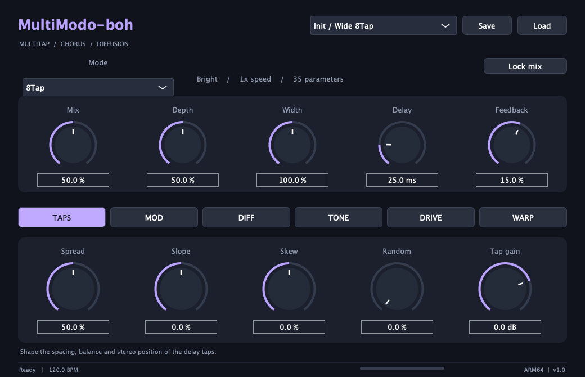

# MultiModo-boh

Plugin di **Valla Productions**, versione **1.0.1**.
**VST3 gratuito per Windows x64; VST3 e AU gratuiti per macOS Apple Silicon**.
Chorus, delay multitap e diffusione modulata, con nove modalità e 35 parametri automatizzabili.



## Download

[Scarica l'ultima release](https://github.com/vallaproductionsoriginal-byte/MultiModo-boh/releases/latest).

Apri la release e scarica il pacchetto per il tuo sistema dalla sezione **Assets**:

- **Windows 10/11 x64:** `MultiModo-boh-win-x64.zip`, con il plugin VST3.
- **macOS 11 o successivo, Apple Silicon arm64:** `MultiModo-boh-mac-arm64.zip`, con VST3 e AU.

I pacchetti contengono i plugin compilati, le istruzioni e gli avvisi di licenza.
Il file `SHA256.txt` consente di verificare entrambi i download.
Questo repository distribuisce VST3 e AU in forma binaria; il codice sorgente non è pubblicato.

## Installazione

### Windows x64

1. Estrai **MultiModo-boh-win-x64.zip**.
2. Copia **l'intera cartella `MultiModo-boh.vst3`** in `C:\Program Files\Common Files\VST3\`.
   Windows può richiedere i privilegi di amministratore per questa cartella.
3. Riavvia la DAW a 64 bit oppure esegui una nuova scansione dei plugin VST3.

Mantieni la struttura del bundle, incluso `Contents\x86_64-win\MultiModo-boh.vst3`.
Il runtime C++ è collegato staticamente; il plugin non ha firma Authenticode.

### macOS Apple Silicon

1. Estrai l'archivio ZIP.
2. Installa il formato supportato dalla tua DAW (puoi installare entrambi):
   - **VST3:** copia l'intera cartella `MultiModo-boh.vst3` in `~/Library/Audio/Plug-Ins/VST3/`.
   - **AU (Audio Unit):** copia l'intera cartella `MultiModo-boh.component` in `~/Library/Audio/Plug-Ins/Components/`.
     Il bundle AU per macOS ha estensione `.component`.
   Crea la cartella di destinazione se non esiste.
3. Riavvia la DAW oppure esegui una nuova scansione dei plugin. Se l'AU non appare, riavvia macOS.

La release richiede una DAW con supporto VST3 o AU eseguita nativamente su Apple Silicon.
I bundle hanno firma ad hoc locale e sono privi di notarizzazione Apple. Se macOS li blocca
dopo il download da questa release ufficiale, puoi rimuovere l'attributo di quarantena
dal solo bundle installato, poi ripetere la scansione:

```sh
xattr -dr com.apple.quarantine "$HOME/Library/Audio/Plug-Ins/VST3/MultiModo-boh.vst3"
```

Per il formato AU, usa il percorso del bundle `.component` installato:

```sh
xattr -dr com.apple.quarantine "$HOME/Library/Audio/Plug-Ins/Components/MultiModo-boh.component"
```

## Controlli

Mix, Depth, Width, Delay e Feedback sono sempre disponibili. Le sei pagine raggruppano
i controlli TAPS, MOD, DIFF, TONE, DRIVE e WARP.

- **Mode:** DimD, VP330, SuperSix, 6TapRandom, DualEnsemble, 8Tap, 16Phase, 16Tap e 32Tap.
- **Diffusione e tono:** diffusione modulata, filtri nel feedback, larghezza stereo e drive.
- **Tempo:** delay libero oppure sincronizzato alla DAW, con suddivisioni regolari, puntate e terzine.
- **Dark e Half Speed:** variazioni del colore, dei tempi di delay e della modulazione.
- **Preset:** dieci impostazioni integrate; Save e Load gestiscono file `.multimodo`.
- **Lock mix:** mantiene il valore Mix durante il richiamo dei preset.
- **Automazione:** 35 parametri; supporto mono e stereo.

Un doppio clic su un knob ripristina il valore predefinito. È possibile digitare
i valori nei campi sotto i knob. Lo stato viene salvato nel progetto della DAW.

## Licenza

Le parti originali di MultiModo-boh e la documentazione sono offerte sotto
[licenza proprietaria](LICENSE). Il download è gratuito.

JUCE 9.0.3 è utilizzato secondo i termini della licenza commerciale **JUCE Starter**.
JUCE e gli altri componenti di terzi mantengono i propri copyright e le rispettive
licenze, descritti in [THIRD_PARTY_NOTICES.md](THIRD_PARTY_NOTICES.md).
La licenza proprietaria del progetto non modifica le licenze dei componenti di terzi.

## Segnalazioni

Per segnalare un problema, [apri una issue](https://github.com/vallaproductionsoriginal-byte/MultiModo-boh/issues)
indicando sistema operativo, DAW, versione del plugin e passi per riprodurlo.
